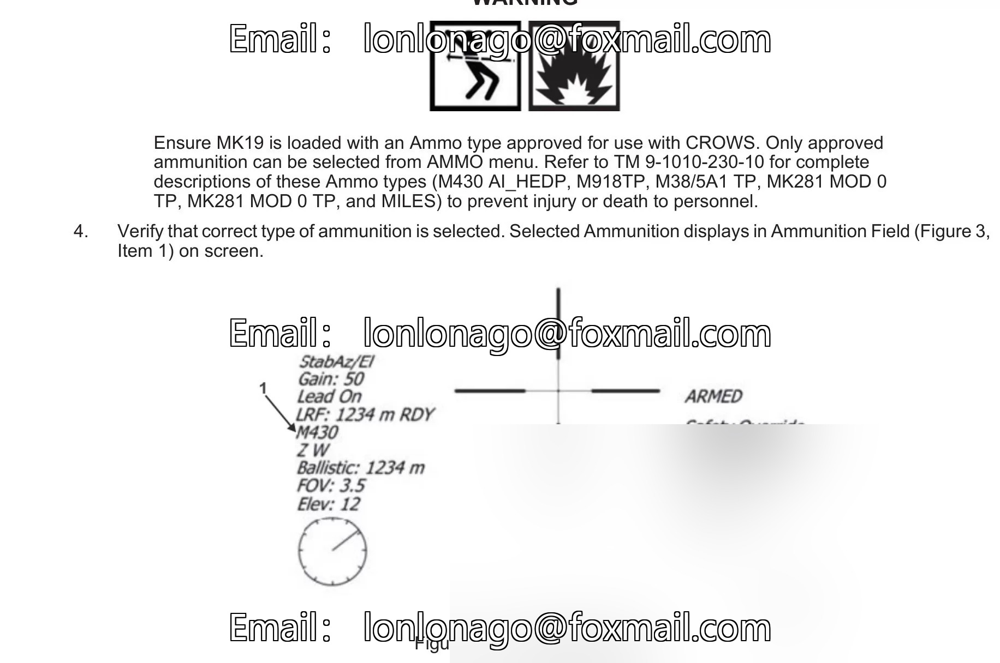
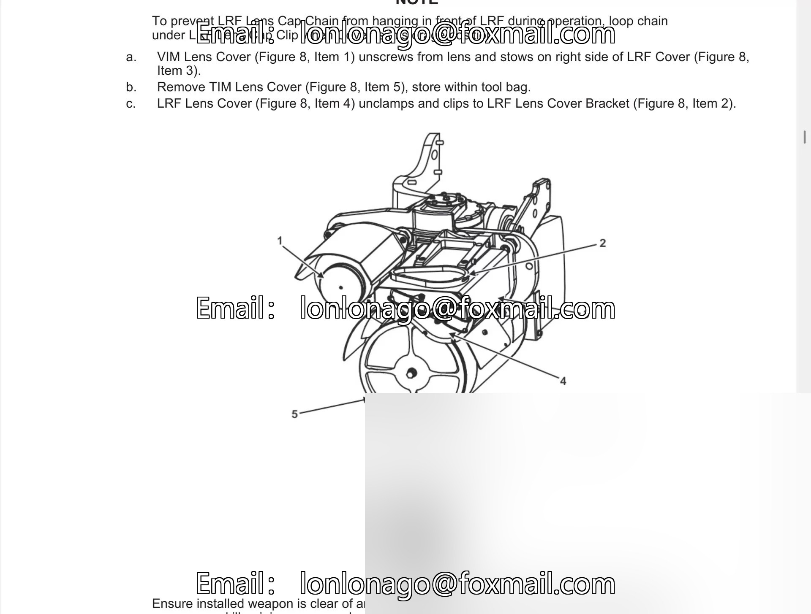

# M153 general-purpose remote weapon station (CROWS) operation guide

## Body

M153 universal remote weapon station (CROWS) operation guide
PDF , 600 pages, detailed content, suitable for study, research, and operational reference.

M153 Common Remotely Operated Weapon Station (CMROWS) is the most widely equipped remotely operated weapon system by the U.S. Army. It is developed by Norway's Constander Defence Company based on the "Protector" RWS and is mainly used to allow occupants inside the vehicle to operate onboard weapons with safe and accurate targeting while being fully protected by armor.

This guide covers M153 common remotely operated weapon station (CROWS) operation, its background, and various equipment parameters and operation details.

<!-- AI_ENRICHED -->

## Images

## Payment

Here is a pay link on Stripe ( https://buy.stripe.com/3cs8yP7sY87d0vu9AB ). Please contact me lonlonago@foxmail.com after funding $89, and I will send you a complete data files , thank you!

